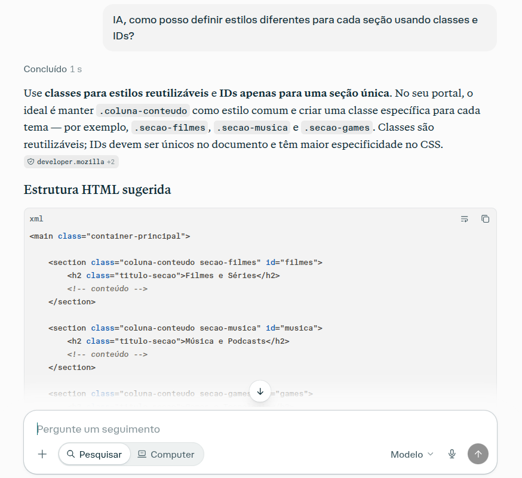
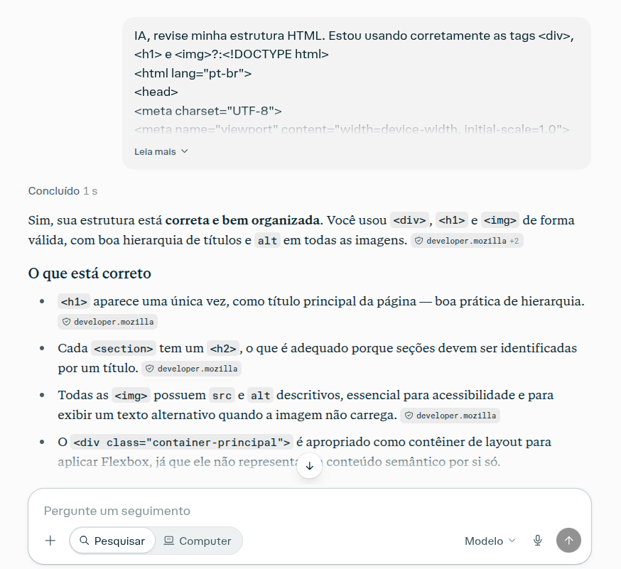
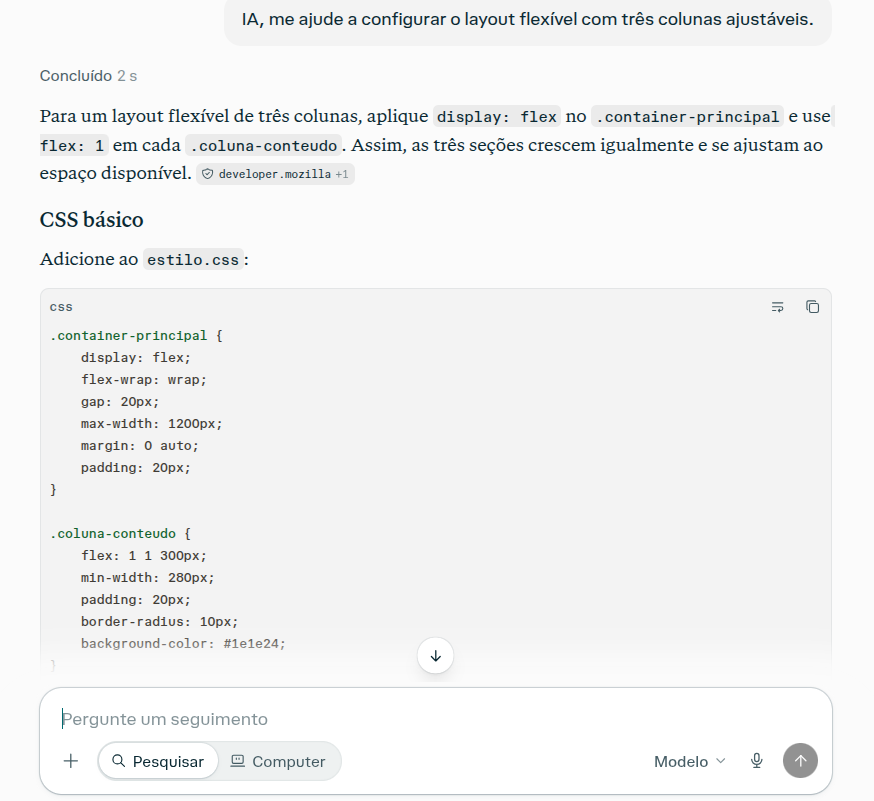

# 🌐 Meu Portal de Entretenimento Digital

Projeto desenvolvido como atividade prática da **Agenda 13 - Desenvolvimento de Sistemas I**. O objetivo principal é criar uma página web temática e responsiva utilizando HTML5 e conceitos avançados de CSS3, como o modelo de layout **Flexbox**, além da aplicação de boas práticas de organização de código.

Este projeto contou com a mentoria técnica de uma Inteligência Artificial para a revisão de estrutura, aplicação de estilos e boas práticas de desenvolvimento.

---

## 🚀 Tecnologias Utilizadas

*   **HTML5:** Estruturação semântica da página.
*   **CSS3:** Estilização moderna dividida em três frentes:
    *   *CSS Reset:* Baseado no modelo de Eric Meyer para consistência entre navegadores.
    *   *CSS Externo:* Arquivo principal (`estilo.css`) com as regras de layout.
    *   *CSS Interno e Inline:* Aplicados pontualmente conforme os requisitos da atividade.
*   **Flexbox:** Utilizado para criar um layout flexível e ajustável de 3 colunas.

---

## 📂 Estrutura do Projeto

A estrutura de arquivos dentro do diretório raiz está organizada da seguinte forma:


```text
portal-entretenimento-css/
├── imagens/         # Pasta exclusiva com os assets visuais do portal HTML
│   ├── filme1.jpg
│   ├── filme2.jpg
│   ├── filme3.jpg
│   ├── games1.jpg
│   ├── games2.jpg
│   ├── games3.jpg
│   ├── musica1.jpg
│   ├── musica2.jpg
│   └── musica3.jpg
├── portal.html      # Página web principal com as seções temáticas
├── estilo.css       # Folha de estilo principal com comentários explicativos
├── reset.css        # Arquivo de reset CSS para padronização dos navegadores
└── README.md        # Documentação do projeto
```

## 📋 Seções do Portal

A página foi dividida em três eixos principais de conteúdo:
1.  **Filmes e Séries:** Críticas, sinopses e imagens de produções audiovisuais.
2.  **Música e Podcasts:** Indicações de álbuns, playlists e programas de áudio.
3.  **Games e Tecnologia:** Novidades do mundo dos jogos e inovações digitais.

---

## 🤖 Registro de Interações com a IA (Mentoria Técnica)

Conforme os critérios de avaliação da atividade, o desenvolvimento foi validado em etapas junto à Inteligência Artificial. Abaixo estão os registros visuais das consultas realizadas:

### Etapa 1 – Estrutura HTML
> *Validação das tags `<div>`, `<h1>` e ``.*
> 
> 

### Etapa 2 – CSS Interno e Externo
> *Definição de estilos específicos usando classes e IDs.*
> 
> 

### Etapa 3 – Flexbox
> *Configuração do layout flexível com três colunas ajustáveis.*
> 
> 

---
👨‍💻 **Desenvolvido por:** Jose Flávio Torres  
📅 **Data:** Novembro de 2026  
🏫 **Curso:** Desenvolvimento de Sistemas I  
